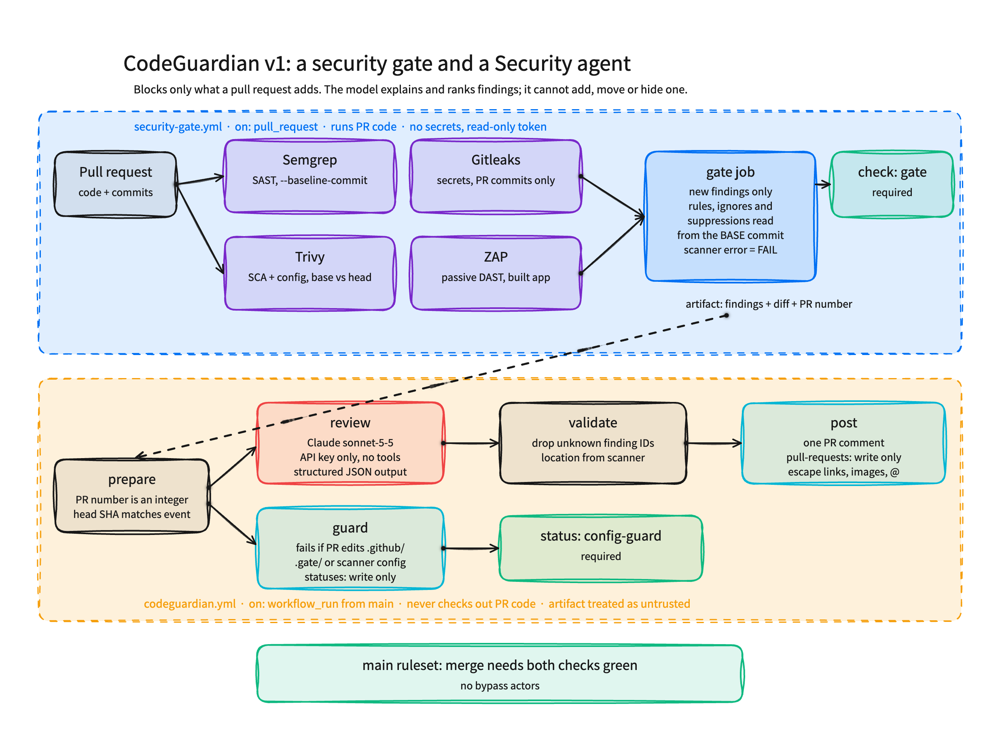

# CodeGuardian

CodeGuardian reviews pull requests for security problems. A deterministic gate runs four
scanners and blocks the merge; a Security agent, backed by a Claude model, explains and
ranks what the scanners found in one pull-request comment. The model cannot add, move or
hide a finding. It can only explain the ones a scanner rule produced.

This is version 1 (week 14 of a security engineering course): the gate, a supervisor and
one Security agent. The repository under test is
[codeguardian-target](https://github.com/Keniolax/codeguardian-target), a pinned copy of
OWASP Juice Shop.



## What it does

**The gate** (`security-gate.yml` in the target repository, on `pull_request`) runs Semgrep,
Gitleaks, Trivy and OWASP ZAP and fails on any finding the pull request adds. It reads its
rules, ignore lists and suppressions from the base commit, so a pull request cannot silence
itself. It has no secrets.

**CodeGuardian** (`codeguardian.yml`, on `workflow_run` from `main`) never checks out the
pull request. It treats the gate's artifact as untrusted data and splits the work so that
no job holds two credentials:

| Job | Holds | Does |
|---|---|---|
| prepare | read access to artifacts | checks the PR number is an integer and the head SHA matches the event |
| review | the Claude API key, no GitHub token | sends findings and the diff to the Security agent; no tools |
| post | `pull-requests: write`, no API key | re-checks the report, escapes it, updates one comment |
| guard | `statuses: write`, `pull-requests: read` | sets `codeguardian/config-guard` for protected configuration changes |

The model returns JSON in a fixed schema (structured outputs), naming findings only by the
gate's finding ID. `report.py` drops any entry with an unknown ID and takes scanner, rule,
file and line from the scanner artifact. Findings the model skips still appear in the
report, marked unexplained. `render.py` escapes all text from the pull request and the model,
so a crafted diff cannot put an image, link, HTML or @-mention in the comment. Reference
links survive only for a short list of documentation hosts.

The default model is `claude-sonnet-5-5`, with server-side fallback on refusal; the report
names the model that answered. `OllamaProvider` runs the same agent on a local model.

## How to run it

In the target repository, open a pull request. The gate runs, then CodeGuardian comments.

The actions in `actions/` are used by the target repository's workflow, pinned by commit
SHA. They need the repository secret `ANTHROPIC_API_KEY`, and this repository's Actions
access set to the owner's repositories.

Locally:

```
python3.12 -m venv .venv && .venv/bin/pip install --require-hashes -r requirements-dev.lock
PYTHONPATH=src .venv/bin/python -m pytest -v
PYTHONPATH=src .venv/bin/python -m codeguardian review --input <gate-artifact-dir> --out report.json
PYTHONPATH=src .venv/bin/python -m codeguardian render --report report.json
```

Dependencies are hash-locked, and every release in the lock files is at least 14 days old.

### Week 17 review options

Add `--with-standards` to the local `review` command to let the reviewer request one record
from its bundled catalog. The model sees the catalog IDs that match scanner rules in the
current review before it sees the PR diff. Code checks the tool name, arguments, and ID
before reading the record. It passes the approved record to the model separately from the
diff. A catalog match adds one model request. The pinned GitHub Action uses the default
review path.

Add `--with-reviewers` to get notes on correctness, missing tests, and documentation.
CodeGuardian can make up to three model requests, even when the scanners find nothing.
Each role reads the first 60,000 characters of the diff on its own. The JSON report records
which model answered each request. The notes appear under **Advisory review** when you
render the report. If an advisory request fails, CodeGuardian saves the scanner report and
any notes it already has. You can use both flags together.

### Week 17 approval for gate changes

Set `approver-id` on the guard action to the GitHub user ID of a maintainer. Set it in the
default-branch workflow. For a protected change, the maintainer reviews the current PR
commit and chooses **Approve** with the review body `Approve CodeGuardian config change`.
Run the guard again when the review decision changes. Each run checks the latest decision
from that maintainer and writes a status on the reviewed commit. The PR author cannot supply
this approval.

The `credential-scope` CI job uses an `actions: read` token to download a one-day fixture
artifact. It also checks that GitHub denies the same token access to secret metadata.

## What was learned

Measured on the seeded pull requests in
[codeguardian-target](https://github.com/Keniolax/codeguardian-target#what-was-learned),
with `claude-sonnet-5-5` on 2026-11-13. The sample is small, and the explanations were
judged by the author, not by an independent reviewer.

| Version | Pull requests with findings | Findings | Wrong claims in explanations | Entries dropped | Model time per review |
|---|---|---|---|---|---|
| diff hunks of flagged files only | 6 | 8 | 3 | 0 | 4.5–8.0 s |
| whole diff and changed-file list (`08973b5`) | 5 | 6 | 0 | 0 | 3.8–6.6 s |

Every seeded finding was ranked first, and none was wrongly called a false positive. Model
cost for the whole week was about $0.10 (about 22,000 input and 5,000 output tokens).

- What the model sees decides what it gets right. With only the hunks of flagged files, it
  said twice that a route had no authentication check (the check was in `server.ts`, which
  it was not shown), and once that the diff was empty (a ZAP finding points at a URL, so no
  hunk was sent). Sending the whole diff, and telling the model to say "not shown" rather
  than "absent", removed all three errors.
- Let the model explain, not decide. The gate decides pass or fail from scanner rules
  alone. The model's output is joined to scanner findings by ID, so a wrong or injected
  answer can change the wording of a comment, not whether a finding exists.
- One job, one credential. The job that reads untrusted text and calls the model has no
  GitHub token; the job that writes to GitHub never calls the model. A stale-report check
  refused to post a report for a commit that was no longer the pull request's head.
- Escape everything that came from the pull request. A comment renderer that passes model
  text through could be made to load an attacker's image URL with data in it. The tests
  cover images, links, HTML and @-mentions.

## Version 2 (in progress)

Version 2 keeps one model of the environment in SQLite: entities such as pods, roles,
buckets and AI agents, and the edges between them, each with its source and time.
Posture, path and detection rules (TOML, in `src/codeguardian/v2/rules/`) all run on that
model. Stage 1 proves this on one recorded chain. An AI agent's pod is reachable from the
internet. Its service account assumes an IAM role, and a CI role then adds a policy that
lets the role read a bucket tagged sensitive. A shell opens in the pod, the pod's token
is read, and the role reads the bucket, which none of the agent's tools declares.

- Collectors read exported files: IAM authorization details, the bucket list and tags,
  `kubectl get -o json`, and a small declared AI inventory. A collector that cannot
  read its file fails; its facts become stale but still count. The output names any
  source that failed, never ran, or is past its refresh period.
- Events (CloudTrail, Kubernetes audit, Falco) are read one at a time from a file or
  stdin and joined to the model. `PutRolePolicy` and `DeleteRolePolicy` change the model
  at once, in whatever order the records arrive. `AttachRolePolicy` carries only an ARN,
  so an unknown policy is marked.
- One path finding covers the chain; removing any one of its six edges removes it.
  The runtime alerts, the cloud events and the path finding form one incident. A shell
  in another pod on the same node stays in its own incident.
- A response plan uses a catalog of three actions and prints commands for a person to
  review. Nothing runs. `explain` and `ask` call a model through v1's `providers.py`;
  answers are joined by ID, and the model cannot open, close or change a finding.
- The IAM resolver reads Allow statements and wildcards only. Anything else (conditions,
  Deny, NotAction, boundaries, SCPs, bucket policies) is listed as not evaluated.

Kubernetes NetworkPolicy is evaluated as the Kubernetes reference defines it. For each pod
that a Service selects, the collector asks one question: can a connection from outside
the cluster reach the pod on one of the Service's target ports? The answer is allowed,
denied or not evaluated. It is stored on the edge from the Service to the pod, and the
path rules cross that edge unless the answer is denied.

- "From outside" means a source address in the outside range. By default the range is
  every IPv4 and IPv6 address; `ingest --outside-source CIDR` makes it smaller. Only an
  `ipBlock`, or a rule with no `from`, can admit such a source, because `podSelector`
  and `namespaceSelector` select pods.
- The model cannot see two facts, and a path that a policy closes depends on both. It
  cannot see whether the cluster's network plugin enforces NetworkPolicy; without such a
  plugin a policy has no effect. It cannot see which source address the pod gets. A load
  balancer or a node can change it, and the reference does not say if that happens
  before or after the policy applies. Traffic from the pod's own node is always allowed.
- The evaluator reads `policyTypes`, `podSelector` and `namespaceSelector` (with
  `matchLabels` and the four `matchExpressions` operators), both selectors in one entry,
  `ipBlock` with `except`, and `ports` with protocol and named ports. Some cases it does
  not decide: a port inside an `endPort` range (plugins differ), a named port not found
  once on the pod, an unknown operator or policy type, a bad CIDR, a pod on the host
  network at either end, a policy whose rules the model does not hold, and a field of a
  shape it does not expect. Each gives "not evaluated" with a note, and the path stays
  open.
- Egress rules are not evaluated. They cannot block a connection into a pod, because
  replies to allowed ingress are allowed. When an egress policy selects the source pod
  of a pod-to-pod question, the answer is "not evaluated".
- `reach` gives the answer for one pod to another. It refuses a port outside 1 to 65535.
  The k8s export now lists namespaces too, because a `namespaceSelector` reads namespace
  labels.

How to run it on the fixtures. `--now` and `--at` set the clock, because the data is
from 2026-11-14.

```
export PYTHONPATH=src
F=fixtures/chain
.venv/bin/python -m codeguardian ingest --db demo.db --now 2026-11-14T10:30:00Z --at 2026-11-14T09:55:00Z \
  --aws-iam $F/aws/iam.json --aws-buckets $F/aws/s3-buckets.json --aws-tags $F/aws/s3-tags.json \
  --k8s $F/k8s/state.json --ai $F/ai/inventory.json
head -n 9 $F/events/chain.ndjson | .venv/bin/python -m codeguardian watch --db demo.db --now 2026-11-14T10:30:00Z
.venv/bin/python -m codeguardian incidents --db demo.db --now 2026-11-14T10:30:00Z
.venv/bin/python -m codeguardian plan --db demo.db --now 2026-11-14T10:30:00Z --incident 83db1215
.venv/bin/python -m codeguardian explain --db demo.db --now 2026-11-14T10:30:00Z --incident 83db1215 \
  --provider recorded --answer $F/explain-answer.json
.venv/bin/python -m codeguardian ask --db demo.db --now 2026-11-14T10:30:00Z --question "Which roles can read sensitive buckets?" \
  --provider recorded --answer $F/ask-answer.json
tail -n 1 $F/events/chain.ndjson | .venv/bin/python -m codeguardian watch --db demo.db --now 2026-11-14T10:30:00Z
.venv/bin/python -m codeguardian findings --db demo.db --now 2026-11-14T10:30:00Z
.venv/bin/python -m codeguardian bench --events 10000 --seed 7
.venv/bin/python tests/mutants.py
```

The two recorded model answers are written by hand. `explain` and `ask` have not been run
against a live model.

The NetworkPolicy layout of a cluster used in the course, written by hand from the
reference: namespace `shop` has a default-deny policy and an allow from namespaces
labelled `access=shop` on TCP 3000. Namespace `client` has that label; `outsider` does not.

```
N=fixtures/netpol
.venv/bin/python -m codeguardian ingest --db course.db --now 2026-11-14T10:30:00Z --at 2026-11-14T09:55:00Z \
  --cluster course --k8s $N/shop.json
.venv/bin/python -m codeguardian reach --db course.db --now 2026-11-14T10:30:00Z \
  --from client/client-7c4b --to shop/shop-web-5d8f --port 3000
.venv/bin/python -m codeguardian reach --db course.db --now 2026-11-14T10:30:00Z \
  --from outsider/outsider-2f9a --to shop/shop-web-5d8f --port 3000
```

Snapshots and records can arrive in any order. Each one is ordered by the time in its
own data, not by when it arrives.

- A snapshot older than the last one applied from the same collector is refused and
  changes nothing. `ingest` prints why and exits 3, each time the snapshot is sent. The
  snapshot the model holds, sent a second time, also changes nothing, and `ingest` exits
  0. A different snapshot with the same time is refused and listed as not evaluated,
  because which of the two held is not known. A broken export older than the last good
  one does not mark its collector failed. A good snapshot older than a broken export, or
  taken at the same time, does not clear the failure.
- An IAM change record for a role the model does not hold yet waits. When a snapshot
  brings the role, the record applies unless it is older than that snapshot. A record
  with the same time as a snapshot counts after it, whichever of the two arrives first.
- A detection that needs an actor or a target the model does not hold, or an edge from a
  collector that has never run, is held. Before, such a record read as "no match". It is
  decided after the next snapshot, against the model as it is then, not as it was at the
  record's time. `findings` lists the records still held.
- The model keeps a journal of every snapshot it was given, the refused older ones
  included, and every IAM change record. `findings --history` replays the journal into a
  new model in memory, in data time, and prints each finding's status changes (opened,
  resolved, reopened) with the time and the snapshot or record that caused each one. A
  path that opened at 10:00 and closed at 10:20 shows even when the delete arrived first
  and the live model never held the path.
- A finding's "first seen" and "last seen" say when this model found it, so they still
  depend on arrival order. A finding found after an older snapshot is dated no earlier
  than the newest snapshot it rests on. The history gives the data time.
- The journal keeps a full copy of each snapshot, so the database grows by the size of
  each export, and `findings --history` replays all of it on each call. A held record
  whose actor never appears stays held and is checked again after every snapshot.

After the commands above, print the history, then give `ingest` an AWS export older than
the one it holds:

```
.venv/bin/python -m codeguardian findings --db demo.db --now 2026-11-14T10:30:00Z --history
.venv/bin/python -m codeguardian ingest --db demo.db --now 2026-11-14T10:30:00Z --at 2026-11-14T09:50:00Z \
  --aws-iam $F/aws/iam.json --aws-buckets $F/aws/s3-buckets.json --aws-tags $F/aws/s3-tags.json
```

To take a snapshot of your own account or cluster, use the export scripts. They run the
`aws` and `kubectl` CLIs you already have, with read calls only, and write the files the
collectors read, with mode 0600, plus a manifest. They refuse to write inside a git work
tree unless git ignores the path (`exports/` is ignored here). Then ingest takes the time
and the cluster name from the manifests. Keep the database under `exports/` too, since it
holds the same real data:

```
.venv/bin/python -m codeguardian.export aws --out exports/aws
.venv/bin/python -m codeguardian.export k8s --out exports/k8s --cluster-name lab
.venv/bin/python -m codeguardian ingest --db exports/model.db --aws-export exports/aws \
  --k8s-export exports/k8s --ai my-inventory.json
```

The cluster name must match the one in your AI inventory. A bucket whose tags cannot be
read (access denied, throttling, a timeout) is kept as "not evaluated", and a failed
IAM, bucket-list or kubectl call stops the export. The k8s export drops env values and
the last-applied annotation, which can hold secrets. The scripts have been tested only
against recorded CLI output from fake `aws` and `kubectl` programs. They have not been
run on a real account or cluster.

The least privilege the export needs:

- AWS: `iam:GetAccountAuthorizationDetails`, `s3:ListAllMyBuckets`, `s3:GetBucketTagging`.
- Kubernetes: `list` on `pods`, `services` and `serviceaccounts` (core group) and on
  `networkpolicies` (`networking.k8s.io`), in all namespaces, and `list` on `namespaces`,
  which are cluster-scoped. kubectl also reads API discovery, which every authenticated
  user may do by default.
- Local only: `kubectl config current-context` reads the kubeconfig, and
  `git check-ignore` reads the repository.

Measured on 2026-11-16, the tests at commit `ac74ec0` and the speed at `dd2dff1`:

- 200 tests pass (25 for v1, 175 for v2, of which 53 are for NetworkPolicy). The
  mutation run removes 158 controls one at a time and runs the tests that name each one:
  210 mutant-test pairs, 145 distinct tests, all fail without their control. One case, a
  pod running as a different service account, has no mutant of its own; that edge is
  absent from the input itself. In the NetworkPolicy tests every parametrized case has a
  mutant of its own, and the run fails if one does not.
- On the course layout (3 namespaces, 3 pods, 1 Service, 2 policies), `reach` answers
  allowed for `client` to `shop` on TCP 3000 and denied for `outsider`. The Service's
  edge answers denied for a connection from outside the cluster.
- 10,010 events (the 10 chain records and 10,000 generated benign records, seed 7),
  each processed in full and committed to an SQLite file in WAL mode with
  `synchronous=NORMAL`, so there is no fsync per commit. Apple M1, macOS 26.6.2, Python
  3.12.14, three runs: 5,969 to 6,527 events per second; per event p50 0.10 to 0.11 ms,
  p95 0.38 to 0.45 ms, max 6.6, 11.4 and 7.1 ms. The chain incident held the same seven
  rules as in a run without noise, and the path finding ended resolved.

Measured on 2026-11-17 at commit `691bfdd`, for the ordering of snapshots and records:

- 219 tests pass (25 for v1, 194 for v2, of which 19 are for ordering). The mutation run
  removes 198 controls one at a time: 259 mutant-test pairs, 164 distinct tests, all fail
  without their control. It now also fails if a test in the ordering file, or one of its
  parametrized cases, has no mutant.
- All 720 orders of six inputs end in one model, one set of open findings and one
  history. The inputs are the stage 1 snapshot (09:55), an AWS snapshot at 10:15 that
  holds the policy the 10:00 put added, and four IAM change records: put at 10:00,
  attach at 10:05, detach at 10:10, delete at 10:20. "One model" covers every live
  entity and edge with its attrs, labels, source and times except "first seen". "One set
  of open findings" covers every field except the first and last seen of a posture or path
  finding. In every order the history shows the path open from 10:00 to 10:20, and the
  detection for permissions added to the agent's role is open.
- The same `bench` as above, on an x86_64 Linux container with Python 3.12.3, three runs
  of each branch in turn: 2,938 to 3,176 events per second on this branch (p50 0.22 to
  0.25 ms, p95 0.74 to 0.79 ms), and 3,204 to 3,328 on `v2/netpol` at `e96375f` (p50 0.21
  to 0.22 ms, p95 0.71 to 0.75 ms). The chain incident held the same seven rules, and the
  path finding ended resolved.
- After the stage 1 snapshot the model file is 147,456 bytes, against 114,688 on
  `v2/netpol`; the journal holds 11,235 bytes of snapshot content.
- After the review fixes at `f84e86f`: 222 tests pass (22 for ordering). The mutation
  run removes 210 controls: 272 mutant-test pairs, all fail without their control.

The data is recorded, not live. At `dd2dff1` the model held 24 entities and 20 edges (the
chain fixture now also lists its 4 namespaces), and the noise
copies the chain's own record shapes, so these numbers do not predict speed on a real
account. They are pipeline time only; CloudTrail delivers a record minutes after the
call, and that delay is not included.

What was learned:

- An event changes the model only as far as the record shows. A guess about a policy
  the record does not carry would read as "safe", so the role is marked instead.
- CloudTrail delivers records out of order, so the order of changes must be kept per
  policy. With one time per role, a `DeleteRolePolicy` that arrived first was forgotten,
  and the late `PutRolePolicy` opened the path finding again. Deletes are now kept as
  tombstones, and all 24 orders of four IAM records end in the same model.
- A passing test can prove less than its name. The first test of "re-run only affected
  rules" still passed when the path rule re-ran on every change. The mutation run found
  this, and a second test now changes only types the path rule does not follow.
- Skipping a policy statement the resolver cannot read is a silent deny. A role with a
  skipped statement, a Deny or a boundary now gets a finding of its own.
- In correlation, the internet node touches every exposed service, so it is left out of
  the join key.
- A control must give the other answer. The first control for a named port gave the
  Service's target port that name, so the policy admitted the traffic, and the "control"
  opened the path as well. The test failed. The control now gives the name to another
  port.
- A test for each claim does not test each guard. A second reader wrote 24 mutations of
  the NetworkPolicy code, and 22 left every test green. In 11 of them a guard that marks
  unread input "not evaluated" gave a deny instead. Input the fixtures did not hold found
  six faults; one was a pod on the host network that read as denied when it was the
  source. Each guard and fault now has a test and a mutant.
- An older snapshot must be refused, or it overwrites newer facts. But it still says
  what held at its own time, so the history has to keep it. With refused snapshots left
  out of the replay, two arrival orders of the same inputs give two histories; the
  mutation run shows it.
- Not looked at yet is not "no". A detection that walked an edge from a collector that
  had never run found no agent behind the role and gave no alert. A record for a role the
  model did not hold yet was dropped. Both now wait for the snapshot that can decide them.
- Keeping a list in data time can cost more than the feature. Sorting a detection's
  records again on every new one made the bench a third slower; one finding held 479
  records. It now sorts only when a record arrives late.
- Every place that compares two times needs the same rule for a tie. A change record at
  the same second as a snapshot counted after the snapshot when the snapshot came first,
  and before it when the record came first. So a path to sensitive data showed in one
  arrival order and not in the other. The 720 orders held no two inputs at one time. A
  review found this fault with such an input, and found two more order faults: a failed
  export that an older good one cleared, and a refused snapshot that read as applied
  when it was sent again.
