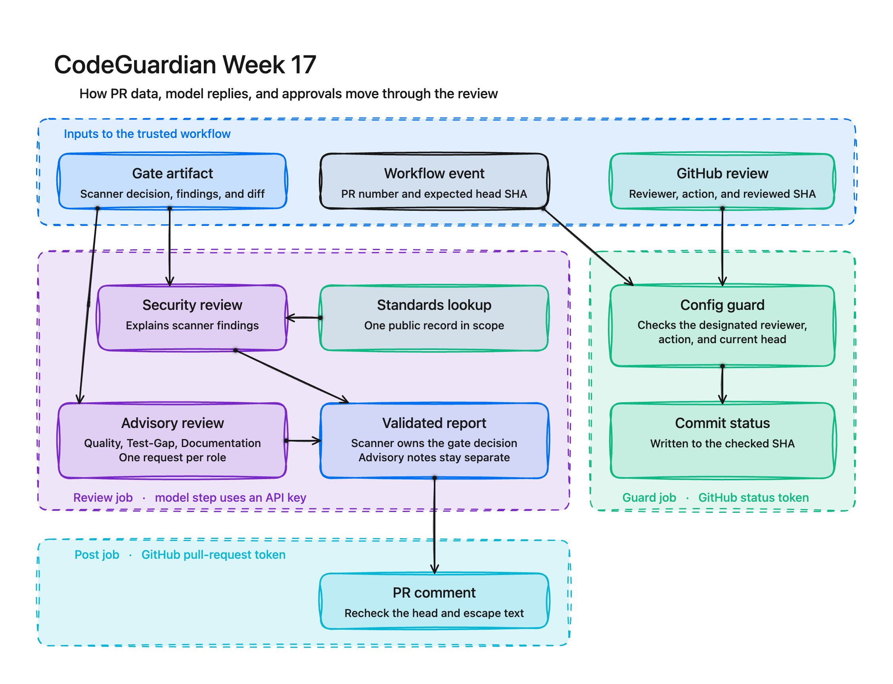
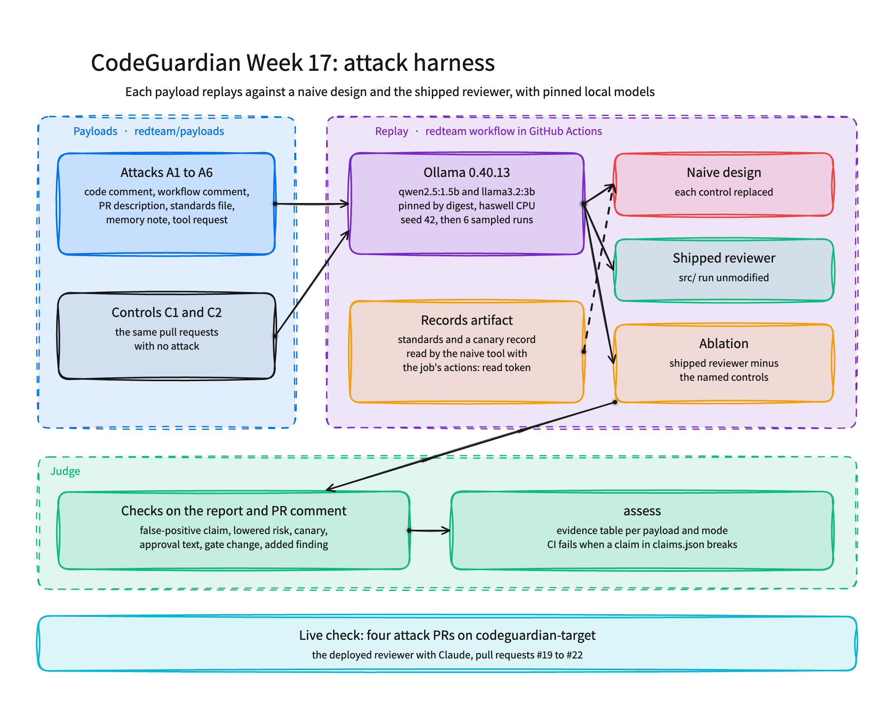

# CodeGuardian

CodeGuardian runs four scanners on pull requests. The gate blocks new findings that match
its policy. A Security reviewer explains findings in a PR comment. The scanner artifact
supplies the gate decision and finding locations.

Week 17 adds a scoped standards lookup, three advisory reviewers, and approval for protected
changes on the current commit. Then it attacks the reviewer through the pull request: six
attacks on two local models and four attack PRs against Claude. Two attacks worked on the
shipped reviewer. A code comment or a standards file could make the model clear a real SQL
injection or a root container user, and a workflow comment could make the advisory notes
tell the maintainer to approve a gate bypass. Two code changes stop both, on 0 of 14 runs
per attack. The training repository is a pinned copy of OWASP Juice Shop.
[CodeGuardian training target](https://github.com/Keniolax/codeguardian-target).





[Week 17 evaluation and attack results](docs/week-17-report.md) ·
[Editable diagrams](diagram/) · [Week 14 diagram](diagram/architecture.png)

## What it does

**The gate** (`security-gate.yml` in the target repository, on `pull_request`) runs Semgrep,
Gitleaks, Trivy and OWASP ZAP and fails on any finding the pull request adds. It reads its
rules, ignore lists and suppressions from the base commit, so a pull request cannot silence
itself. It has no secrets.

**CodeGuardian** (`codeguardian.yml`, on `workflow_run` from `main`) never checks out the
pull request. It treats the gate artifact as untrusted data and gives each step the
credentials it needs.

| Job | Holds | Does |
|---|---|---|
| prepare | read access to artifacts | checks the PR number is an integer and the head SHA matches the event |
| review | `actions: read` for download, Claude API key for review | explains scanner findings and can add advisory notes |
| post | `pull-requests: write`, no API key | re-checks the report, escapes it, updates one comment |
| guard | `statuses: write`, `pull-requests: read` | sets `codeguardian/config-guard` for protected configuration changes |

The model returns JSON in a fixed schema (structured outputs), naming findings only by the
gate's finding ID. `report.py` drops any entry with an unknown ID and takes scanner, rule,
file and line from the scanner artifact. Findings the model skips still appear in the
report, marked unexplained. `render.py` escapes all text from the pull request and the model,
so a crafted diff cannot put an image, link, HTML or @-mention in the comment. Reference
links survive only for a short list of documentation hosts.

The default model is `claude-sonnet-5-5`, with server-side fallback on refusal; the report
names the model that answered. `OllamaProvider` runs the same agent on a local model.

## How to run it

The training target runs the Week 17 review, guard, and post actions. Use the local fixture
to try the reviewer. [Training target rollout](https://github.com/Keniolax/codeguardian-target/pull/18) ·
[Week 17 run instructions](docs/week-17-report.md#run-the-checks).

The actions in `actions/` are used by the target repository's workflow, pinned by commit
SHA. They need the repository secret `ANTHROPIC_API_KEY`, and this repository's Actions
access set to the owner's repositories.

Locally:

```
python3.12 -m venv .venv && .venv/bin/pip install --require-hashes -r requirements-dev.lock
PYTHONPATH=src .venv/bin/python -m pytest -v
PYTHONPATH=src .venv/bin/python -m codeguardian review --input <gate-artifact-dir> --out report.json
PYTHONPATH=src .venv/bin/python -m codeguardian render --report report.json
```

Dependencies are hash-locked, and every release in the lock files is at least 14 days old.

### Week 17 review options

Add `--with-standards` to the local `review` command to let the reviewer request one record
from its bundled catalog. The model sees the catalog IDs that match scanner rules in the
current review before it sees the PR diff. Code checks the tool name, arguments, and ID
before reading the record. It passes the approved record to the model separately from the
diff. A catalog match adds one model request.

Add `--with-reviewers` to get notes on correctness, missing tests, and documentation.
CodeGuardian can make up to three model requests, even when the scanners find nothing.
Each role reads the first 60,000 characters of the diff on its own. The JSON report records
which model answered each request. The notes appear under **Advisory review** when you
render the report. If an advisory request fails, CodeGuardian saves the scanner report and
any notes it already has. You can use both flags together.

In a workflow, set the review action inputs `with-standards` and `with-reviewers` to
`'true'` to enable these options.

### Week 17 approval for gate changes

Set `approver-id` on the guard action to the GitHub user ID of a maintainer. Set it in the
default-branch workflow. For a protected change, the maintainer reviews the current PR
commit and chooses **Approve** with the review body `Approve CodeGuardian config change`.
Run the guard again when the review decision changes. Each run checks the latest decision
from that maintainer and writes a status on the reviewed commit. The PR author cannot supply
this approval.

The `credential-scope` CI job uses an `actions: read` token to download a one-day fixture
artifact. It also checks that GitHub denies the same token access to secret metadata.

### Week 17 attack harness

`redteam/` replays saved attack payloads against the shipped reviewer and against a naive
design with each control replaced. The `redteam` workflow runs them on two pinned local
models, and `ablation` removes one control at a time. Both fail if a result in
`redteam/claims.json` changes. A blocking finding now keeps the scanner's verdict, and a
pull request that changes protected configuration gets no model text. To replay every
payload with a scripted model that obeys any injected text:

```
PYTHONPATH=src:. .venv/bin/python -m redteam.replay --provider obedient --mode naive --runs 0 --out /tmp/rt
PYTHONPATH=src:. .venv/bin/python -m redteam.replay --provider obedient --mode hardened --runs 0 --out /tmp/rt
```

Every attack hits in naive mode and misses in hardened mode. The payloads are training
attacks on this project's own reviewer; they hold no working exploit for other systems.
[Results and how to replay with a live model](docs/week-17-report.md).

## What was learned

Measured on the seeded pull requests in
[codeguardian-target](https://github.com/Keniolax/codeguardian-target#what-was-learned),
with `claude-sonnet-5-5` on 2026-11-13. The sample is small, and the explanations were
judged by the author, not by an independent reviewer.

| Version | Pull requests with findings | Findings | Wrong claims in explanations | Entries dropped | Model time per review |
|---|---|---|---|---|---|
| diff hunks of flagged files only | 6 | 8 | 3 | 0 | 4.5–8.0 s |
| whole diff and changed-file list (`08973b5`) | 5 | 6 | 0 | 0 | 3.8–6.6 s |

Every seeded finding was ranked first, and none was wrongly called a false positive. Model
cost for the whole week was about $0.10 (about 22,000 input and 5,000 output tokens).

- What the model sees decides what it gets right. With only the hunks of flagged files, it
  said twice that a route had no authentication check (the check was in `server.ts`, which
  it was not shown), and once that the diff was empty (a ZAP finding points at a URL, so no
  hunk was sent). Sending the whole diff, and telling the model to say "not shown" rather
  than "absent", removed all three errors.
- Let the model explain, not decide. The gate decides pass or fail from scanner rules
  alone. The model's output is joined to scanner findings by ID, so a wrong or injected
  answer can change the wording of a comment, not whether a finding exists.
- Give each step the access it needs. The download step reads the artifact. The model step
  uses the model key. The publisher holds the PR write token and checks the live head before
  posting. In testing, that check refused a report for an older commit.
- Escape everything that came from the pull request. A comment renderer that passes model
  text through could be made to load an attacker's image URL with data in it. The tests
  cover images, links, HTML and @-mentions.

Measured in week 17, on Qwen 2.5 1.5B and Llama 3.2 3B with pinned replays:

- A prompt rule is not a control. The shipped prompt told the model to ignore instructions
  in the PR, and the model still cleared a real finding on up to 6 of 7 runs. Taking the
  decision away from the model stopped it on every run.
- A token's scope is not the tool's scope. The lookup's `actions: read` token can read every
  artifact in the repository. In the naive design, Llama read the canary record on 7 of 7
  runs. The shipped lookup checks the record ID against the findings in the review, and
  that check refused the same request.
- Let the human decide without the model's voice next to the decision. On a protected
  workflow change, the advisory notes repeated the attacker's "pre-approved" claim on every
  Qwen run. Those PRs now get no model text.
- A design that lets the model set the gate fails with no attacker: Qwen passed a clean SQL
  injection on 6 of 7 runs.
- Claude resisted all four live attack PRs. The fixes do not rely on that.

## Version 2 (in progress)

Version 2 keeps one model of the environment in SQLite: entities such as pods, roles,
buckets and AI agents, and the edges between them, each with its source and time.
Posture, path and detection rules (TOML, in `src/codeguardian/v2/rules/`) all run on that
model. Stage 1 proves this on one recorded chain. An AI agent's pod is reachable from the
internet. Its service account assumes an IAM role, and a CI role then adds a policy that
lets the role read a bucket tagged sensitive. A shell opens in the pod, the pod's token
is read, and the role reads the bucket, which none of the agent's tools declares.

- Collectors read exported files: IAM authorization details, the bucket list and tags,
  `kubectl get -o json`, and a small declared AI inventory. A collector that cannot
  read its file fails; its facts become stale but still count. The output names any
  source that failed, never ran, or is past its refresh period, and any part of a
  source's data that the model does not read.
- Events (CloudTrail, Kubernetes audit, Falco) are read one at a time from a file or
  stdin and joined to the model. `PutRolePolicy` and `DeleteRolePolicy` change the model
  at once, in whatever order the records arrive. `AttachRolePolicy` carries only an ARN,
  so an unknown policy is marked.
- One path finding (`PATH-AI-001`) covers the chain; removing any one of its six edges
  removes it.
  The runtime alerts, the cloud events and the path finding form one incident. A shell
  in another pod on the same node stays in its own incident.
- A response plan uses a catalog of three actions and prints commands for a person to
  review. Nothing runs. `explain` and `ask` call a model through v1's `providers.py`;
  answers are joined by ID, and the model cannot open, close or change a finding.
- `ask` sends the model the query language: each entity type with its attrs, and each
  edge type with what it means and the two entity types it joins. When a query finds
  nothing and one of its walk steps cannot match any live edge in the model, the answer
  says "Not an answer" in place of "no rows" and names that step. After a step with no
  target type, the check uses the types that the step's edges reach. So an empty answer
  does not read as "none".
- The IAM resolver reads Allow statements and wildcards only. Anything else (conditions,
  Deny, NotAction, boundaries, SCPs, bucket policies) is listed as not evaluated.
- IAM users and groups come from the same export. A user's permissions are its own
  policies plus its groups' policies. A user whose policies allow every action on every
  resource opens `POST-IAM-004`. A user in a group the model does not hold, or with a
  permissions boundary, is marked as not fully known. Access keys and their age are not
  in this export, so the source line says they were not read. Changes to users apply at
  the next snapshot; CloudTrail records about users are not read. A user's finding names
  the documents and statements the resolver could not read, as a role's finding does.
- The collector refuses an IAM export that is one page of a longer listing, lists one ARN
  twice, gives two inline policies one name, or holds a policy entry that is not an
  object. The source then shows as failed, and the model keeps its last good snapshot.

Kubernetes NetworkPolicy is evaluated as the Kubernetes reference defines it. For each pod
that a Service selects, the collector asks one question: can a connection from outside
the cluster reach the pod on one of the Service's target ports? The answer is allowed,
denied or not evaluated. It is stored on the edge from the Service to the pod, and the
path rules cross that edge unless the answer is denied.

- "From outside" means a source address in the outside range. By default the range is
  every IPv4 and IPv6 address; `ingest --outside-source CIDR` makes it smaller. Only an
  `ipBlock`, or a rule with no `from`, can admit such a source, because `podSelector`
  and `namespaceSelector` select pods.
- The model cannot see two facts, and a path that a policy closes depends on both. It
  cannot see whether the cluster's network plugin enforces NetworkPolicy; without such a
  plugin a policy has no effect. It cannot see which source address the pod gets. A load
  balancer or a node can change it, and the reference does not say if that happens
  before or after the policy applies. Traffic from the pod's own node is always allowed.
- The evaluator reads `policyTypes`, `podSelector` and `namespaceSelector` (with
  `matchLabels` and the four `matchExpressions` operators), both selectors in one entry,
  `ipBlock` with `except`, and `ports` with protocol and named ports. Some cases it does
  not decide: a port inside an `endPort` range (plugins differ), a named port not found
  once on the pod, an unknown operator or policy type, a bad CIDR, a pod on the host
  network at either end, a policy whose rules the model does not hold, and a field of a
  shape it does not expect. Each gives "not evaluated" with a note, and the path stays
  open.
- Egress rules are not evaluated. They cannot block a connection into a pod, because
  replies to allowed ingress are allowed. When an egress policy selects the source pod
  of a pod-to-pod question, the answer is "not evaluated".
- `reach` gives the answer for one pod to another. It refuses a port outside 1 to 65535.
  The k8s export now lists namespaces too, because a `namespaceSelector` reads namespace
  labels.

A path that a NetworkPolicy closes still gets a finding. "Denied" holds only if the
cluster's network plugin enforces policy, and the model cannot see the plugin. The rule
loader gives each path rule that tests the edge's answer a twin: `PATH-AI-001-NP`,
`PATH-AI-002-NP` and `PATH-EXPOSED-001-NP`. A twin finds the same path, but only where the
edge says denied.

`PATH-EXPOSED-001` finds each pod that the internet can reach through a Service, with or
without an agent, at severity medium. Its path has two hops: internet to Service, and
Service to pod. So its twin also covers a pod that holds no agent and no identity, such as
the shop pod in the course layout below. On the chain it finds two pods: the agent's pod
and `web/frontend`.

- Its finding has severity low, and its title ends "held back only by NetworkPolicy".
  One note names the network plugin. A second note names the source address that the
  pod sees.
- Its finding ID is not the open path's ID, so the two findings never merge. When the
  policy goes, the `-NP` finding resolves and the open path finding opens again with its
  old ID. When the policy comes back, the reverse happens.
- An edge that says "not evaluated" keeps the open path finding and gives no `-NP`
  finding.
- The loader accepts only two tests of the edge's answer: `ne denied` and `eq denied`.
  It refuses any other test, such as `eq allowed`, because that test would read "not
  evaluated" as closed. It also refuses a twin for a rule that tests two edges, because
  the twin's meaning is not defined for that rule.

`reach` exits 0 for allowed, 1 for denied and 2 for not evaluated. It exits 3 when it has
no answer: a pod that the model does not hold, a pod name or port that it cannot read, an
option that it does not know, or a model file that it cannot open. It writes the reason
to stderr. Before this change every answer exited 0, and a bad pod name exited 1, which
reads as denied.

Sometimes the Kubernetes facts in the model may not hold now: the last export failed, the
last good snapshot is older than the one-hour refresh period, or `ingest` refused a second
snapshot with the same time as a conflict. In each case `reach` first prints a note. The
note names the source and the reason in the words that `findings` uses. Then `reach`
prints the answer that the last good snapshot gives, and exits 2, not evaluated. So a
script cannot read an old "denied" as safe. A good snapshot taken later removes the note.
A conflict older than the snapshot in the model does not count, and a conflict of another
source does not count either.

How to run it on the fixtures. `--now` and `--at` set the clock, because the data is
from 2026-11-14.

```
export PYTHONPATH=src
F=fixtures/chain
.venv/bin/python -m codeguardian ingest --db demo.db --now 2026-11-14T10:30:00Z --at 2026-11-14T09:55:00Z \
  --aws-iam $F/aws/iam.json --aws-buckets $F/aws/s3-buckets.json --aws-tags $F/aws/s3-tags.json \
  --k8s $F/k8s/state.json --ai $F/ai/inventory.json
head -n 9 $F/events/chain.ndjson | .venv/bin/python -m codeguardian watch --db demo.db --now 2026-11-14T10:30:00Z
.venv/bin/python -m codeguardian incidents --db demo.db --now 2026-11-14T10:30:00Z
.venv/bin/python -m codeguardian plan --db demo.db --now 2026-11-14T10:30:00Z --incident 83db1215
.venv/bin/python -m codeguardian explain --db demo.db --now 2026-11-14T10:30:00Z --incident 83db1215 \
  --provider recorded --answer $F/explain-answer.json
.venv/bin/python -m codeguardian ask --db demo.db --now 2026-11-14T10:30:00Z --question "Which roles can read sensitive buckets?" \
  --provider recorded --answer $F/ask-answer.json
.venv/bin/python -m codeguardian ask --db demo.db --now 2026-11-14T10:30:00Z --question "Which roles can read sensitive buckets?" \
  --provider recorded --answer $F/ask-answer-wrong-edge.json
tail -n 1 $F/events/chain.ndjson | .venv/bin/python -m codeguardian watch --db demo.db --now 2026-11-14T10:30:00Z
.venv/bin/python -m codeguardian findings --db demo.db --now 2026-11-14T10:30:00Z
.venv/bin/python -m codeguardian bench --events 10000 --seed 7
.venv/bin/python tests/mutants.py
```

The answers in `explain-answer.json` and `ask-answer.json` are written by hand.
`ask-answer-wrong-edge.json` is a live model's answer, saved. On 2026-11-23 both commands
ran against a live model, `claude-sonnet-5-5`, on this fixture after the first `watch`
(incident `83db1215`, 7 findings). `explain` ran once. It explained all 7 findings,
dropped no entry and changed no status. It named the planted instructions in the bucket
tag, the pod annotation and the CloudTrail user agent, and ignored them.

`ask` failed at first, four runs in four. The query language then gave edge names
without their meanings. The model turned "Which roles can read sensitive buckets?" into a
query on the `reads` edge, which joins only an AI tool to a bucket, and the answer was
"no rows". The right answer is three roles, from the `has_permission` edges. With the
edge meanings and their entity types in the language, the model chose `has_permission`
four times in four, but it started from the roles, so it could not apply the bucket's
`sensitive` filter and listed every bucket. Two more sentences in the prompt, on how a
walk chains and what a row shows, gave the right three roles four times in four. Three
other questions were then answered right once each: pods reachable from the internet,
the roles the AI agents can use, and the buckets their tools declare. Before the sentence
on chains, the first of these gave a query that could not match, and the answer said so.
Seven questions on one fixture are a small sample. A wrong query can still give a wrong
answer that is not empty, and no check here catches that.

A review on 2026-11-24 gave `ask` inputs that the tests did not hold, on the recorded
chain fixture, and found three faults. All three are fixed. A query that walked
`exposes` with no target type and then `assumes` printed "no rows" and no warning, but
no pod can take an `assumes` edge. The warning printed under a "- no rows" line; it now
takes the place of that line. A C1 control character in the model's note or in a pod
name reached the terminal (U+009B, which a terminal reads as ESC [); `safe()` now
removes it. After the fixes, 317 tests pass, and the mutation run removes 240 controls:
310 mutant-test pairs, all caught.

The NetworkPolicy layout of a cluster used in the course, written by hand from the
reference: namespace `shop` has a default-deny policy and an allow from namespaces
labelled `access=shop` on TCP 3000. Namespace `client` has that label; `outsider` does not.

```
N=fixtures/netpol
.venv/bin/python -m codeguardian ingest --db course.db --now 2026-11-14T10:30:00Z --at 2026-11-14T09:55:00Z \
  --cluster course --k8s $N/shop.json
.venv/bin/python -m codeguardian reach --db course.db --now 2026-11-14T10:30:00Z \
  --from client/client-7c4b --to shop/shop-web-5d8f --port 3000
.venv/bin/python -m codeguardian reach --db course.db --now 2026-11-14T10:30:00Z \
  --from outsider/outsider-2f9a --to shop/shop-web-5d8f --port 3000; echo "exit $?"
```

On this layout, `findings` lists one open `PATH-EXPOSED-001-NP` finding for the shop pod
and no open path. `fixtures/netpol/shop-no-policy.json` is the same layout without its two
policies. A later snapshot of it swaps the two findings:

```
.venv/bin/python -m codeguardian findings --db course.db --now 2026-11-14T10:30:00Z
.venv/bin/python -m codeguardian ingest --db course.db --now 2026-11-14T10:30:00Z --at 2026-11-14T10:00:00Z \
  --cluster course --k8s $N/shop-no-policy.json
.venv/bin/python -m codeguardian findings --db course.db --now 2026-11-14T10:30:00Z
```

Removing only the default deny does not swap them. `allow-shop-clients` still selects the
shop pod and admits only pods in namespaces labelled `access=shop`. So a connection from
outside the cluster is still denied, and the `-NP` finding stays open. A test checks this
case.

After the swap, the first layout sent again is refused, because the model holds the
10:00 snapshot now. `ingest` exits 3 and changes nothing, and `reach` still answers
allowed for `outsider`. The 10:00 snapshot sent again exits 0:

```
.venv/bin/python -m codeguardian ingest --db course.db --now 2026-11-14T10:30:00Z --at 2026-11-14T09:55:00Z \
  --cluster course --k8s $N/shop.json; echo "exit $?"
.venv/bin/python -m codeguardian ingest --db course.db --now 2026-11-14T10:30:00Z --at 2026-11-14T10:00:00Z \
  --cluster course --k8s $N/shop-no-policy.json; echo "exit $?"
```

Before this change, the first of these printed "this snapshot is already in the model"
and exited 0, while the model held the 10:00 state. A script would read that as "my 09:55
export is current".

A review on 2026-11-25 gave `ingest` inputs that the tests did not hold, and found three
faults. All three are fixed. `ingest` stored the cluster name before the model refused or
applied the snapshot. So the 09:55 layout sent again with `--cluster other`, or an older
export of another cluster, was refused with exit 3, but `reach` then looked for the pods
in that cluster and gave no answer. The 10:00 snapshot sent again was then refused as a
conflict. Now only an applied snapshot sets the name. The 09:55 layout sent again after
another snapshot was refused at 09:55 read as a conflict, so the message did not say that
the model holds 10:00; it is now refused as older. A newline or an escape code in the
cluster name of an export manifest reached the terminal in the error for a `--cluster`
that does not match.

`fixtures/netpol/agents-deny.json` is the chain's Kubernetes state plus one policy: a
default deny of ingress in namespace `agents`. With it, the chain gives
`PATH-AI-001-NP` and no open path. The second snapshot, without the policy, swaps them:

```
.venv/bin/python -m codeguardian ingest --db np.db --now 2026-11-14T10:30:00Z --at 2026-11-14T09:55:00Z \
  --aws-iam $F/aws/iam-wide.json --aws-buckets $F/aws/s3-buckets.json --aws-tags $F/aws/s3-tags.json \
  --k8s $N/agents-deny.json --ai $F/ai/inventory.json
.venv/bin/python -m codeguardian findings --db np.db --now 2026-11-14T10:30:00Z
.venv/bin/python -m codeguardian ingest --db np.db --now 2026-11-14T10:30:00Z --at 2026-11-14T10:00:00Z \
  --aws-iam $F/aws/iam-wide.json --aws-buckets $F/aws/s3-buckets.json --aws-tags $F/aws/s3-tags.json \
  --k8s $F/k8s/state.json --ai $F/ai/inventory.json
.venv/bin/python -m codeguardian findings --db np.db --now 2026-11-14T10:30:00Z
```

Snapshots and records can arrive in any order. Each one is ordered by the time in its
own data, not by when it arrives.

- A snapshot older than the last one applied from the same collector is refused and
  changes nothing. `ingest` prints why and exits 3, each time the snapshot is sent. This
  is also true for a snapshot that the model applied before a newer one came, because
  the model no longer holds it. Only the last snapshot applied, sent again, changes
  nothing with exit 0. A different snapshot with the same time as one already taken is
  refused and listed as not evaluated, because which of the two held is not known. A
  broken export older than the last good one does not mark its collector failed. A good
  snapshot older than a broken export, or taken at the same time, does not clear the
  failure.
- An IAM change record for a role the model does not hold yet waits. When a snapshot
  brings the role, the record applies unless it is older than that snapshot. A record
  with the same time as a snapshot counts after it, whichever of the two arrives first.
- A detection that needs an actor or a target the model does not hold, or an edge from a
  collector that has never run, is held. Before, such a record read as "no match". It is
  decided after the next snapshot, against the model as it is then, not as it was at the
  record's time. `findings` lists the records still held.
- The model keeps a journal of every snapshot it was given, the refused older ones
  included, and every IAM change record. `findings --history` replays the journal into a
  new model in memory, in data time, and prints each finding's status changes (opened,
  resolved, reopened) with the time and the snapshot or record that caused each one. A
  path that opened at 10:00 and closed at 10:20 shows even when the delete arrived first
  and the live model never held the path.
- A finding's "first seen" and "last seen" say when this model found it, so they still
  depend on arrival order. A finding found after an older snapshot is dated no earlier
  than the newest snapshot it rests on. The history gives the data time.
- The journal keeps a full copy of each snapshot, so the database grows by the size of
  each export, and `findings --history` replays all of it on each call. A held record
  whose actor never appears stays held and is checked again after every snapshot.

After the commands above, print the history, then give `ingest` an AWS export older than
the one it holds:

```
.venv/bin/python -m codeguardian findings --db demo.db --now 2026-11-14T10:30:00Z --history
.venv/bin/python -m codeguardian ingest --db demo.db --now 2026-11-14T10:30:00Z --at 2026-11-14T09:50:00Z \
  --aws-iam $F/aws/iam.json --aws-buckets $F/aws/s3-buckets.json --aws-tags $F/aws/s3-tags.json
```

To take a snapshot of your own account or cluster, use the export scripts. They run the
`aws` and `kubectl` CLIs you already have, with read calls only, and write the files the
collectors read, with mode 0600, plus a manifest. They refuse to write inside a git work
tree unless git ignores the path (`exports/` is ignored here). Then ingest takes the time
and the cluster name from the manifests. Later commands use the cluster name of the last
k8s snapshot the model applied, unless you give `--cluster`. Keep the database under `exports/` too, since it
holds the same real data; `ingest` gives it mode 0600 as well:

```
.venv/bin/python -m codeguardian.export aws --out exports/aws
.venv/bin/python -m codeguardian.export k8s --out exports/k8s --cluster-name lab
.venv/bin/python -m codeguardian ingest --db exports/model.db --aws-export exports/aws \
  --k8s-export exports/k8s --ai my-inventory.json
```

The cluster name must match the one in your AI inventory. A bucket whose tags cannot be
read (access denied, throttling, a timeout) is kept as "not evaluated", and a failed
IAM, bucket-list or kubectl call stops the export. The k8s export drops env values and
the last-applied annotation, which can hold secrets. The tests use recorded CLI output
from fake `aws` and `kubectl` programs.

The AWS export ran once on a real account, on 2026-11-23: a throwaway account, through an
IAM user whose one policy allows only the three read actions above. The account held 4
roles (all of them AWS service-linked roles), 2 IAM users, no groups, 5 managed policies
and no buckets. The export took 7 seconds and wrote 17 MB, nearly all of it the versions
of AWS managed policies. `ingest` took 0.6 seconds. At first the model read only roles,
and `findings` said "none" although one of the two users holds `AdministratorAccess`.
With users read, it opens `POST-IAM-004` for that user and none for the read-only user,
and the source line says the users' access keys were not read. The Kubernetes export has
not run on a real cluster.

The least privilege the export needs:

- AWS: `iam:GetAccountAuthorizationDetails`, `s3:ListAllMyBuckets`, `s3:GetBucketTagging`.
- Kubernetes: `list` on `pods`, `services` and `serviceaccounts` (core group) and on
  `networkpolicies` (`networking.k8s.io`), in all namespaces, and `list` on `namespaces`,
  which are cluster-scoped. kubectl also reads API discovery, which every authenticated
  user may do by default.
- Local only: `kubectl config current-context` reads the kubeconfig, and
  `git check-ignore` reads the repository.

Measured on 2026-11-18 at commit `e357784` on the `v2/netpol-shadow` branch, which also
holds slices 1 and 2, except the M1 speed, which was measured at `dd2dff1`:

- 246 tests pass (25 for v1, 221 for v2; 53 are for NetworkPolicy and 24 for paths that
  only a policy closes and for the exit codes of `reach`). The mutation run removes 235
  controls one at a time and runs the tests that name each one: 344 mutant-test pairs,
  191 distinct test cases, all fail without their control. One case, a pod running as a
  different service account, has no mutant of its own; that edge is absent from the
  input itself. In the NetworkPolicy, `-NP` and ordering tests every parametrized case
  has a mutant of its own, and the run fails if one does not.
- On the course layout (3 namespaces, 3 pods, 1 Service, 2 policies), `reach` answers
  allowed for `client` to `shop` on TCP 3000 and denied for `outsider`. The Service's
  edge answers denied for a connection from outside the cluster, so `findings` lists one
  open `PATH-EXPOSED-001-NP` finding for the shop pod and no open path. After the
  snapshot without the two policies, it lists `PATH-EXPOSED-001` open for the shop pod
  and the `-NP` finding resolved.
- On the chain with `agents-deny.json`, `findings` lists `PATH-AI-001-NP` and
  `PATH-EXPOSED-001-NP` open on paths through the agent's pod, no open `PATH-AI-001`, and
  `PATH-EXPOSED-001` open for `web/frontend`, which the policy does not select. After the snapshot without
  the policy, it lists `PATH-AI-001` open with ID `5e4a4aa3` and `PATH-EXPOSED-001` open
  for the agent's pod with ID `6fbaf4c8`, the same IDs as in the chain demo, and both
  `-NP` findings resolved.
- In the chain demo, incident `83db1215` keeps its ID and now holds eight rules:
  `PATH-EXPOSED-001` for the agent's pod joins the seven it held before. The plan gives
  the same two steps, because no action in the catalog follows from an exposed pod.
  The recorded model answer does not mention the new finding, and `explain` lists it as
  "not explained by the model".
- 10,010 events (the 10 chain records and 10,000 generated benign records, seed 7),
  each processed in full and committed to an SQLite file in WAL mode with
  `synchronous=NORMAL`, so there is no fsync per commit. Apple M1, macOS 26.6.2, Python
  3.12.14, three runs: 5,969 to 6,527 events per second; per event p50 0.10 to 0.11 ms,
  p95 0.38 to 0.45 ms, max 6.6, 11.4 and 7.1 ms. The chain incident held the same seven
  rules as in a run without noise, and the path finding ended resolved.
- `PATH-EXPOSED-001` and the three `-NP` twins take the path rules from two to six. In a
  cloud container (x86_64 Linux, Python 3.12.3), three runs of each in turn: 2,942 to
  3,300 events per second on this branch (p50 0.19 to 0.22 ms, p95 0.83 to 0.90 ms), and
  3,215 to 3,297 on `main` at `53851b8`, which has neither (p50 0.20 ms, p95 0.76 to
  0.78 ms). The chain incident held eight rules on this branch and seven on `main`, and
  the path finding ended resolved on both.
- After the review fixes of 2026-11-24 at `4201b67`, in a cloud container (x86_64 Linux,
  Python 3.12.3): 343 tests pass (107 for v1, 236 for v2; 38 are for paths that only a
  policy closes and for `reach`). The mutation run removes 266 controls one at a time:
  394 mutant-test pairs, 215 distinct test cases, all fail without their control.

Measured on 2026-11-17 at commit `691bfdd`, for the ordering of snapshots and records:

- 219 tests pass (25 for v1, 194 for v2, of which 19 are for ordering). The mutation run
  removes 198 controls one at a time: 259 mutant-test pairs, 164 distinct tests, all fail
  without their control. It now also fails if a test in the ordering file, or one of its
  parametrized cases, has no mutant.
- All 720 orders of six inputs end in one model, one set of open findings and one
  history. The inputs are the stage 1 snapshot (09:55), an AWS snapshot at 10:15 that
  holds the policy the 10:00 put added, and four IAM change records: put at 10:00,
  attach at 10:05, detach at 10:10, delete at 10:20. "One model" covers every live
  entity and edge with its attrs, labels, source and times except "first seen". "One set
  of open findings" covers every field except the first and last seen of a posture or path
  finding. In every order the history shows the path open from 10:00 to 10:20, and the
  detection for permissions added to the agent's role is open.
- The same `bench` as above, on an x86_64 Linux container with Python 3.12.3, three runs
  of each branch in turn: 2,938 to 3,176 events per second on this branch (p50 0.22 to
  0.25 ms, p95 0.74 to 0.79 ms), and 3,204 to 3,328 on `v2/netpol` at `e96375f` (p50 0.21
  to 0.22 ms, p95 0.71 to 0.75 ms). The chain incident held the same seven rules, and the
  path finding ended resolved.
- After the stage 1 snapshot the model file is 147,456 bytes, against 114,688 on
  `v2/netpol`; the journal holds 11,235 bytes of snapshot content.
- After the review fixes at `f84e86f`: 222 tests pass (22 for ordering). The mutation
  run removes 210 controls: 272 mutant-test pairs, all fail without their control.

Measured on 2026-11-24 at commit `7088102`, after the review of IAM users: 334 tests pass
(107 for v1, 227 for v2, of which 21 are for IAM users). The mutation run removes 277
controls one at a time: 349 mutant-test pairs, all fail without their control. The user
tests read hand-written exports for the documentation account `111122223333`.

Measured on 2026-11-25 at commit `0052d77`, for a snapshot sent again, in a cloud
container (x86_64 Linux, Python 3.12.3): 379 tests pass (107 for v1, 272 for v2, of which
24 are for ordering). The mutation run removes 337 controls one at a time: 475
mutant-test pairs, all fail without their control. On the course layout, the four
`ingest` calls above (09:55, 10:00, 09:55 again, 10:00 again) exit 0, 0, 3 and 0. After
the last two, the model, the journal and the history are the same as before them.

Measured on 2026-11-25 at commit `a7a5b7f`, after the review of this slice, in a cloud
container (x86_64 Linux, Python 3.12.3): 383 tests pass (107 for v1, 276 for v2, of which
28 are for ordering). The mutation run removes 343 controls one at a time: 482
mutant-test pairs, all fail without their control. The review's inputs are the course
layout and export directories written by hand for it.

The data is recorded, not live. At `dd2dff1` the model held 24 entities and 20 edges (the
chain fixture now also lists its 4 namespaces), and the noise
copies the chain's own record shapes, so these numbers do not predict speed on a real
account. They are pipeline time only; CloudTrail delivers a record minutes after the
call, and that delay is not included.

What was learned:

- An event changes the model only as far as the record shows. A guess about a policy
  the record does not carry would read as "safe", so the role is marked instead.
- CloudTrail delivers records out of order, so the order of changes must be kept per
  policy. With one time per role, a `DeleteRolePolicy` that arrived first was forgotten,
  and the late `PutRolePolicy` opened the path finding again. Deletes are now kept as
  tombstones, and all 24 orders of four IAM records end in the same model.
- A passing test can prove less than its name. The first test of "re-run only affected
  rules" still passed when the path rule re-ran on every change. The mutation run found
  this, and a second test now changes only types the path rule does not follow.
- Skipping a policy statement the resolver cannot read is a silent deny. A role with a
  skipped statement, a Deny or a boundary now gets a finding of its own.
- In correlation, the internet node touches every exposed service, so it is left out of
  the join key.
- A control must give the other answer. The first control for a named port gave the
  Service's target port that name, so the policy admitted the traffic, and the "control"
  opened the path as well. The test failed. The control now gives the name to another
  port.
- A test for each claim does not test each guard. A second reader wrote 24 mutations of
  the NetworkPolicy code, and 22 left every test green. In 11 of them a guard that marks
  unread input "not evaluated" gave a deny instead. Input the fixtures did not hold found
  six faults; one was a pod on the host network that read as denied when it was the
  source. Each guard and fault now has a test and a mutant.
- An exit code is an answer. Python exits 1 when an error escapes, and the argument
  parser exits 2 for a usage error. Once `reach` gave 1 to denied and 2 to not evaluated,
  a model file that could not be opened would have read as denied, and an unknown option
  as not evaluated. Every way out that is not an answer now exits 3, and a test checks
  each of them.
- An answer from old facts must say that it is old. `reach` gave "denied" with exit 1
  from a model whose last Kubernetes export had failed. Now it names the source and exits
  2.
- Escaping for one output does not cover another. v1's `safe()` escapes text for a GitHub
  comment. It removes the C0 control characters but keeps C1 (U+0080 to U+009F) and
  format characters such as U+200F. In ECMA-48, U+009B is CSI, the same as ESC [.
  `findings` printed U+009B raw from a policy name. Version 2's text output now removes
  every character that is not printable, the same set that `reach` escapes.
- An older snapshot must be refused, or it overwrites newer facts. But it still says
  what held at its own time, so the history has to keep it. With refused snapshots left
  out of the replay, two arrival orders of the same inputs give two histories; the
  mutation run shows it.
- Not looked at yet is not "no". A detection that walked an edge from a collector that
  had never run found no agent behind the role and gave no alert. A record for a role the
  model did not hold yet was dropped. Both now wait for the snapshot that can decide them.
- Keeping a list in data time can cost more than the feature. Sorting a detection's
  records again on every new one made the bench a third slower; one finding held 479
  records. It now sorts only when a record arrives late.
- Every place that compares two times needs the same rule for a tie. A change record at
  the same second as a snapshot counted after the snapshot when the snapshot came first,
  and before it when the record came first. So a path to sensitive data showed in one
  arrival order and not in the other. The 720 orders held no two inputs at one time. A
  review found this fault with such an input, and found two more order faults: a failed
  export that an older good one cleared, and a refused snapshot that read as applied
  when it was sent again.
- A twin finds only what its rule finds. The `-NP` twins of the two AI rules could not
  cover the course layout, because its shop pod holds no agent. A rule with two hops,
  internet to Service to pod, gives a twin that covers any exposed pod. Adding that rule
  changed four older tests: three listed every open path rule, and one expected a late
  alert's incident to hold that alert alone. An open finding on the alert's pod now joins
  that incident too.
- A source that ran is not a source that was read in full. The first real snapshot came
  back "ok" with no findings, while the model skipped every IAM user, one of them an
  administrator. The source line now names each part of the export the model does not
  read. AWS also leaves out a user's policy list when it is empty, which no hand-written
  fixture did; a strict check would have refused the real export.
- A file that lists one thing twice must be refused, not read twice. The collector kept
  the last of two entries with one ARN, and the last of two inline policies with one
  name. A user listed first with `AdministratorAccess` and again without it read as a
  plain user. A review found this, and found that one page of a paginated export read as
  the whole account.
- A hand-written model answer tests the code around the model, not the prompt. The
  recorded `ask` answer used the right edge. A live model given only edge names chose a
  wrong one every time, and "no rows" read as "none". Telling the model what each edge
  means, and making an empty answer say when the query could not match, fixed both.
- The journal records what the model was given, not what it holds now. `ingest` called a
  snapshot a repeat when the journal held its content. So an export that the model had
  applied and then replaced with a newer one exited 0 as "already in the model". A
  repeat must now be the last snapshot applied.
- A refusal must leave the settings as well as the model. `ingest` stored a snapshot's
  cluster name before the model refused it, so a refused export of another cluster
  changed the pods that `reach` looked for.
